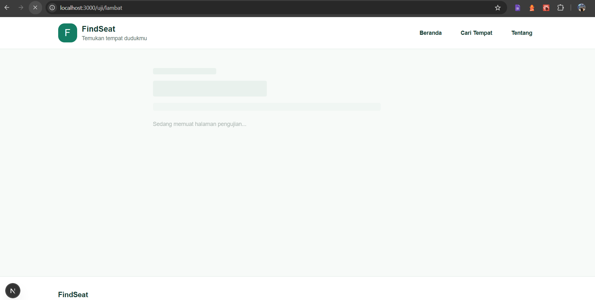
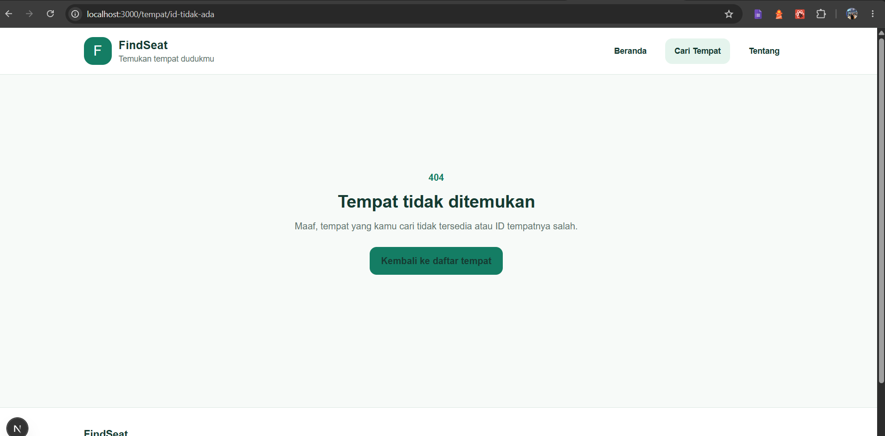
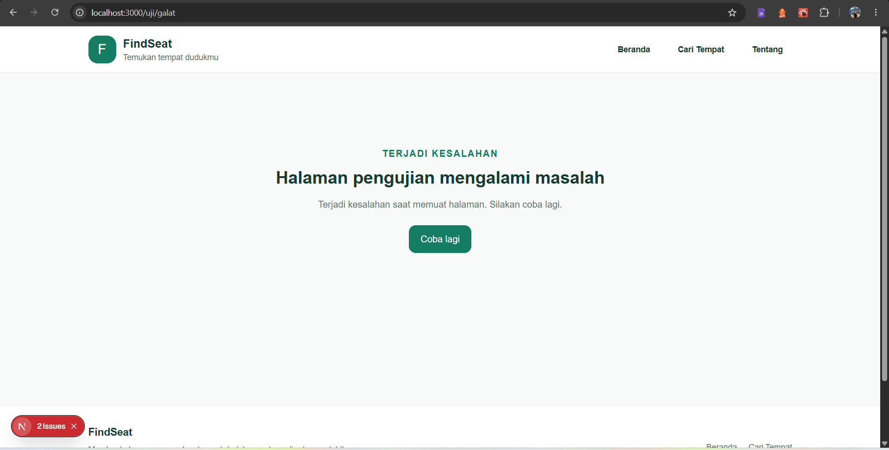
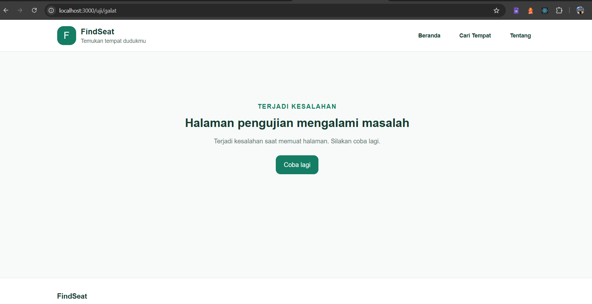
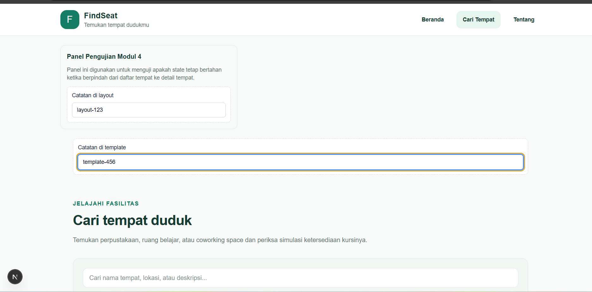
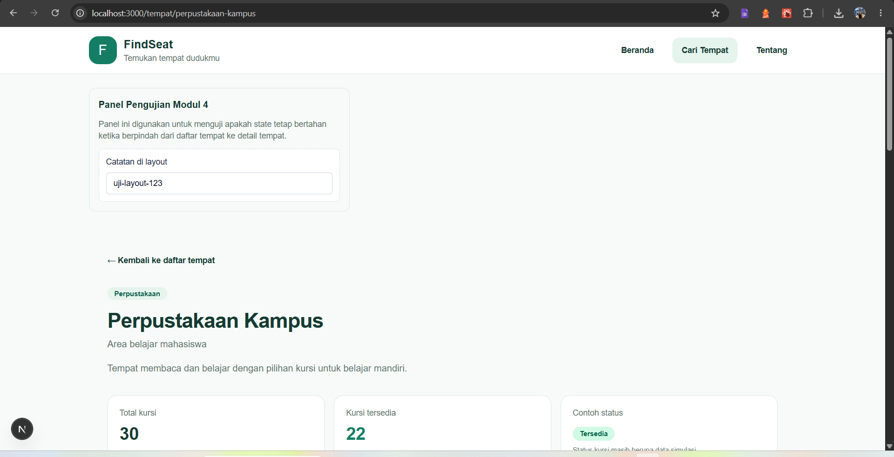
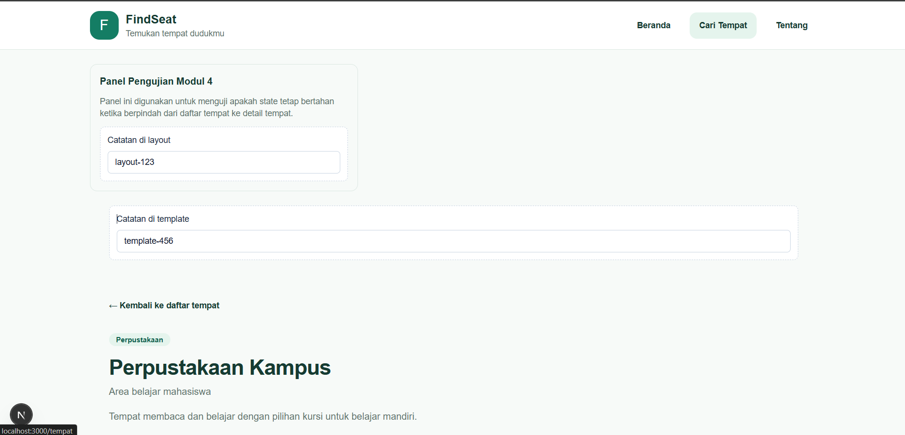

# Dokumen Teknis Modul 4: Next.js App Router

**Nama/NIM:** M. Rizki Ruswan / 105224018  
**Repositori:** https://github.com/mrizkiruswan-lab/105224018-FindSeat  
**Versi Next.js:** 16.4.0  
**Mode Cache Components:** Aktif (`cacheComponents: true`)

> Catatan pengumpulan: bagian bukti gambar merujuk ke file di folder `evidence/`. Masukkan screenshot yang sesuai dengan nama file yang disebutkan di bawah sebelum mengumpulkan dokumen.

## 1. Peta Route

Aplikasi FindSeat merupakan web untuk mencari tempat belajar dan melihat simulasi ketersediaan kursi. Rute utama menggunakan Next.js App Router dengan file `page.tsx`. Rute detail tempat menggunakan segmen dinamis `[id]`.

| URL | Berkas | Jenis rute / rendering dari hasil build | Isi halaman |
|---|---|---|---|
| `/` | `app/page.tsx` | Static (`○`) | Beranda FindSeat |
| `/_not-found` | `app/not-found.tsx` / fallback Next.js | Static (`○`) | Halaman ketika rute tidak ditemukan |
| `/tempat` | `app/tempat/page.tsx` | Static (`○`) | Daftar tempat, pencarian, dan filter kategori |
| `/tempat/[id]` | `app/tempat/[id]/page.tsx` | Partial Prerender (`◐`) | Detail tempat berdasarkan ID |
| `/tempat/perpustakaan-kampus` | Hasil `generateStaticParams()` | Static (`○`) | Detail Perpustakaan Kampus |
| `/tempat/ruang-belajar` | Hasil `generateStaticParams()` | Static (`○`) | Detail Ruang Belajar Bersama |
| `/tempat/coworking-space` | Hasil `generateStaticParams()` | Static (`○`) | Detail Coworking Space |
| `/tentang` | `app/tentang/page.tsx` | Static (`○`) | Informasi tentang FindSeat |

Keterangan simbol pada keluaran `next build`:
- `○` — halaman diprerender sebagai konten statis.
- `◐` — Partial Prerender; sebagian HTML diprerender dan konten dinamis dapat dialirkan dari server.

Route pengujian `/uji/galat` dan `/uji/lambat` digunakan sementara untuk memeriksa error boundary dan loading state. Kedua route tersebut telah dihapus sebelum build final, sehingga tidak muncul pada tabel route build final.

### Pohon folder `app/` setelah pembersihan route uji

```text
app/
├── layout.tsx
├── page.tsx
├── not-found.tsx
├── globals.css
├── tempat/
│   ├── layout.tsx
│   ├── template.tsx
│   ├── page.tsx
│   ├── loading.tsx
│   ├── error.tsx
│   └── [id]/
│       ├── page.tsx
│       └── DetailTempatClient.tsx
└── tentang/
    └── page.tsx
```

Pohon di atas merangkum struktur yang terlihat selama pengerjaan. Cocokkan kembali dengan Explorer sebelum pengumpulan jika ada perubahan setelah pengujian terakhir.

## 2. Layout, Template, dan Berkas Khusus

### 2.1 Layout

`app/layout.tsx` merupakan root layout yang menyediakan kerangka bersama aplikasi, metadata, header, area konten utama, dan footer. `app/tempat/layout.tsx` menyediakan panel pengujian untuk membandingkan perilaku state ketika berpindah dari daftar tempat ke detail tempat.

### 2.2 Template

`app/tempat/template.tsx` menampilkan kolom catatan pengujian. Berbeda dari layout, template dibuat ulang ketika navigasi yang sesuai memicu remount segmen. Pada percobaan manual, catatan template dan layout diisi lalu diamati ketika berpindah antara `/tempat` dan `/tempat/perpustakaan-kampus`.

**Interpretasi pengujian:** layout dimaksudkan mempertahankan state selama layout yang sama tetap terpasang. Template dapat di-mount ulang ketika navigasi terjadi, sehingga state lokalnya dapat kembali ke nilai awal. Hasil observasi yang disertakan pada screenshot menjadi bukti visual untuk perbandingan ini.

### 2.3 Loading UI

File `app/tempat/loading.tsx` menyediakan tampilan loading pada segmen tempat. Route `/uji/lambat` pernah digunakan untuk memperlihatkan skeleton loading selama proses tertunda. Setelah route pengujian dihapus, bukti screenshot perlu tetap disimpan sebagai dokumentasi pengujian sebelum pembersihan.



### 2.4 Error UI dan not-found

File `app/tempat/error.tsx` menangani error pada segmen tempat dan menyediakan mekanisme mencoba kembali. File `app/not-found.tsx` menyediakan halaman 404 khusus. Validasi ID tempat dilakukan pada `app/tempat/[id]/page.tsx` dengan mencari ID pada data `venues`; jika ID tidak ditemukan, fungsi `notFound()` dipanggil.

Bukti halaman ID tidak ditemukan:



Bukti error boundary pada mode development:



Bukti error boundary pada mode production:



### 2.5 Perbandingan layout dan template

| Aspek | Layout | Template |
|---|---|---|
| File pada proyek | `app/tempat/layout.tsx` | `app/tempat/template.tsx` |
| Fungsi | Membungkus halaman pada segmen tempat | Membungkus halaman dengan perilaku mount ulang saat navigasi yang sesuai |
| State lokal | Dapat bertahan selama instance layout tetap digunakan | Dapat diinisialisasi ulang ketika template di-mount ulang |
| Bukti | Catatan pada panel layout sebelum/sesudah navigasi | Catatan pada panel template sebelum/sesudah navigasi |

Bukti tampilan daftar tempat dengan panel layout dan template:



Bukti tampilan panel pada halaman detail tempat:





## 3. Rute Dinamis dan Validasi `params`

Rute detail menggunakan `app/tempat/[id]/page.tsx`. Pada Next.js versi yang digunakan, `params` ditangani sebagai Promise dan diambil dengan `await params`. Fungsi `generateStaticParams()` mengembalikan ID dari data `venues`, sehingga tiga tempat yang tersedia dapat diprerender.

Alur validasi:
1. Terima parameter `id` dari URL.
2. Tunggu dan ambil nilai `id` dari `params`.
3. Cari tempat yang memiliki `item.id === id` pada data `venues`.
4. Jika tidak ditemukan, panggil `notFound()` agar Next.js menampilkan halaman 404.
5. Jika ditemukan, render komponen detail tempat.

### Tabel pengujian rute

| URL / perintah | Hasil yang diharapkan | Hasil aktual berdasarkan pengujian | Status HTTP |
|---|---|---|---|
| `http://localhost:3000/tempat` | Daftar tempat tampil | Daftar tempat tampil | Belum dicatat dengan `curl.exe` |
| `http://localhost:3000/tempat/perpustakaan-kampus` | Detail Perpustakaan Kampus tampil | Halaman detail tampil | Belum dicatat dengan `curl.exe` |
| `http://localhost:3000/tempat/ruang-belajar` | Detail Ruang Belajar Bersama tampil | Route tercantum pada hasil build; tampilan perlu diverifikasi bila belum diuji manual | Belum dicatat dengan `curl.exe` |
| `http://localhost:3000/tempat/coworking-space` | Detail Coworking Space tampil | Route tercantum pada hasil build; tampilan perlu diverifikasi bila belum diuji manual | Belum dicatat dengan `curl.exe` |
| `http://localhost:3000/tempat/id-tidak-ada` | Halaman 404 khusus tampil | Halaman “Tempat tidak ditemukan” tampil | `404` (terverifikasi melalui `curl.exe`) |

Untuk mengisi kode status HTTP secara langsung pada PowerShell, jalankan server aplikasi lalu gunakan:

```powershell
curl.exe -s -o NUL -w "%{http_code}`n" http://localhost:3000/tempat
curl.exe -s -o NUL -w "%{http_code}`n" http://localhost:3000/tempat/perpustakaan-kampus
curl.exe -s -o NUL -w "%{http_code}`n" http://localhost:3000/tempat/id-tidak-ada
curl.exe -s -o NUL -w "%{http_code}`n" http://localhost:3000/rute-tidak-ada
```

Pengujian aktual yang telah dilakukan menghasilkan status `200` untuk `/tempat`, `200` untuk `/tempat/perpustakaan-kampus`, `404` untuk `/tempat/id-tidak-ada`, dan `404` untuk `/rute-tidak-ada`. Hasil ini menunjukkan rute valid merespons sukses, sedangkan ID tempat yang tidak dikenal dan rute global yang tidak tersedia merespons 404.

## 4. Pembagian Server dan Client Components

| Komponen / berkas | Jenis | Alasan teknis |
|---|---|---|
| `app/layout.tsx` | Server Component | Root layout menyediakan struktur dan metadata tanpa membutuhkan state client |
| `app/tempat/page.tsx` | Client Component | Menggunakan `useState` dan `useMemo` untuk pencarian serta filter interaktif |
| `components/KolomCatatan.tsx` | Client Component | Mengelola nilai input catatan menggunakan state React |
| `components/TautanNav.tsx` | Client Component | Dibuat untuk perilaku navigasi aktif yang memerlukan `usePathname()` |
| `components/SiteHeader.tsx` | Perlu diperiksa | Target pemisahan adalah menjadikan header sebagai Server Component dan menempatkan logika pathname pada `TautanNav.tsx` |
| `app/tempat/[id]/page.tsx` | Server Component | Membaca parameter, memvalidasi data tempat, dan memanggil `notFound()` |
| `app/tempat/[id]/DetailTempatClient.tsx` | Client Component | Menangani interaksi pada halaman detail yang membutuhkan browser state |
| `lib/mock-data.ts` | Modul data | Menyediakan data tempat dan kursi simulasi |

### Uji impor modul server-only dari Client Component

Arahan modul meminta pengujian bahwa modul data server yang dilindungi dengan `import "server-only"` tidak boleh diimpor dari Client Component. Status pelaksanaan dan hasil build khusus pengujian ini **belum terkonfirmasi dari bukti yang tersedia**. Jika sudah dilakukan, tuliskan hasil aktual dan sertakan pesan build yang relevan. Jangan meninggalkan impor yang sengaja merusak build pada versi final.

## 5. Verifikasi

Pemeriksaan akhir dilakukan setelah route pengujian sementara dihapus dan cache Next.js dibersihkan.

| Perintah | Hasil aktual |
|---|---|
| `npx tsc --noEmit` | Berhasil, tidak menampilkan error |
| `npm run lint` | Berhasil, ESLint tidak melaporkan error |
| `npm run build` | Berhasil |
| `curl.exe` untuk `/tempat` | HTTP 200 |
| `curl.exe` untuk `/tempat/perpustakaan-kampus` | HTTP 200 |
| `curl.exe` untuk `/tempat/id-tidak-ada` | HTTP 404 |
| `curl.exe` untuk `/rute-tidak-ada` | HTTP 404 |
| Route `/uji/galat` dan `/uji/lambat` | Tidak lagi muncul pada hasil build final |
| `/` | Static |
| `/tempat` | Static |
| `/tempat/[id]` | Partial Prerender |
| `/tempat/perpustakaan-kampus` | Static |
| `/tempat/ruang-belajar` | Static |
| `/tempat/coworking-space` | Static |
| `/tentang` | Static |

Build final menampilkan rute-rute di atas dan selesai tanpa error. Bukti hasil terminal dapat ditambahkan sebagai screenshot tersendiri bila diwajibkan dosen.

## 6. Kendala dan Penyelesaian

### 6.1 State input pada template

**Kendala:** nilai catatan pada template berubah atau hilang ketika berpindah halaman.

**Penyelesaian:** perilaku ini digunakan untuk membandingkan lifecycle template dengan layout. State lokal pada template dapat diinisialisasi ulang ketika template di-mount ulang, sedangkan layout dapat mempertahankan instance dan state selama navigasi pada segmen yang sama.

### 6.2 Lint pada indikator mount

**Kendala:** ESLint melaporkan `react-hooks/set-state-in-effect` ketika state indikator mount diubah secara sinkron di dalam `useEffect`.

**Penyelesaian:** implementasi indikator disesuaikan agar pemeriksaan lint dapat berjalan tanpa error. Pada pemeriksaan akhir, `npm run lint` berhasil.

### 6.3 Cache tipe Next.js setelah route uji dihapus

**Kendala:** TypeScript masih mencari `app/uji/galat/page.js` dan `app/uji/lambat/page.js` dari file validator di `.next`, padahal folder route uji sudah dihapus.

**Penyelesaian:** folder hasil build/cache `.next` dihapus lalu pemeriksaan TypeScript, lint, dan build dijalankan ulang. Setelah cache dibuat ulang, ketiganya berhasil.

### 6.4 Build route error uji

**Kendala:** build awal gagal saat route `/uji/galat` menggunakan `connection()` dengan cara yang tidak sesuai untuk konfigurasi Cache Components.

**Penyelesaian:** route uji disesuaikan agar menjadi dynamic route dengan `export const instant = false` dan `connection()`. Build kemudian berhasil, route diuji pada production, lalu route uji sementara dihapus sebelum build final.

## 7. Catatan Pemanfaatan AI

AI digunakan sebagai alat bantu untuk menjelaskan konsep Next.js App Router, menyusun dan memperbaiki beberapa bagian kode, membantu menganalisis pesan error, serta menyusun draf dokumentasi teknis.

Bagian yang dibantu meliputi:
- penjelasan struktur route, layout, template, loading UI, error boundary, dan validasi ID;
- analisis error TypeScript, ESLint, dan build;
- penyusunan draf tabel route, hasil verifikasi, serta penjelasan kendala.

Hasil bantuan diverifikasi dengan menjalankan `npx tsc --noEmit`, `npm run lint`, dan `npm run build`, serta melakukan pengujian manual di browser pada halaman detail, 404, loading, dan error boundary. Tanggung jawab akhir untuk memeriksa kode, bukti screenshot, dan kesesuaian laporan tetap berada pada mahasiswa.

