# Dokumentasi Praktikum Modul 6

## PostgreSQL dan Prisma ORM pada Produk FindSeat

**Nama:** M. Rizki Ruswan\
**Program Studi:** Ilmu Komputer\
**Produk:** FindSeat\
**Modul:** 6 -- PostgreSQL dan Prisma ORM

------------------------------------------------------------------------

## 1. Tujuan Praktikum

Praktikum ini bertujuan mengintegrasikan PostgreSQL dengan aplikasi
FindSeat menggunakan Prisma ORM. Kegiatan meliputi perancangan struktur
basis data, pembuatan relasi antartabel, migrasi, pengisian data awal,
implementasi CRUD, serta pengujian transaksi untuk menjaga konsistensi
data.

## 2. Deskripsi Produk

FindSeat merupakan aplikasi web untuk membantu pengguna menemukan dan
memilih tempat duduk di ruang publik, seperti perpustakaan kampus, ruang
belajar bersama, dan coworking space. Aplikasi menyediakan daftar
tempat, denah kursi, status ketersediaan, serta fitur check-in. Pada
modul ini, data aplikasi diintegrasikan dengan PostgreSQL agar tersimpan
secara persisten.

## 3. Konfigurasi PostgreSQL

Database yang digunakan adalah PostgreSQL 18 dengan nama `findseat_db`,
dikelola melalui pgAdmin 4. Koneksi aplikasi menggunakan environment
variable `DATABASE_URL` pada file `.env`. File tersebut tidak disertakan
ke repositori untuk menjaga kerahasiaan kredensial.

Konfigurasi Prisma berada pada `prisma.config.ts`, yang menunjuk ke
schema `prisma/schema.prisma`, direktori migrasi `prisma/migrations`,
dan perintah seed `tsx prisma/seed.ts`.

## 4. Perancangan Struktur Database

Database FindSeat memiliki tiga model utama:

  Model       Fungsi
  ----------- ------------------------------------------------------
  `Venue`     Menyimpan informasi tempat atau lokasi.
  `Seat`      Menyimpan nomor, status, dan relasi kursi ke tempat.
  `CheckIn`   Menyimpan catatan pengguna yang melakukan check-in.

### 4.1 Model Venue

Model `Venue` menyimpan `id`, `slug`, `name`, `category`, `location`,
`description`, dan `createdAt`. Satu venue dapat memiliki banyak kursi.

### 4.2 Model Seat

Model `Seat` menyimpan `id`, `number`, `status`, `venueId`, dan
`createdAt`. Status kursi menggunakan enum `SeatStatus`, yaitu
`tersedia`, `digunakan`, dan `ditinggalkan`. Setiap kursi terhubung ke
satu venue. Kombinasi `venueId` dan `number` dibuat unik agar nomor
kursi tidak terduplikasi dalam venue yang sama.

### 4.3 Model CheckIn

Model `CheckIn` menyimpan `id`, `name`, `email`, `seatId`,
`checkedInAt`, dan `checkedOutAt`. Setiap catatan check-in terhubung ke
satu kursi. Relasi Seat dan CheckIn menggunakan `onDelete: Restrict`,
sehingga kursi yang memiliki riwayat check-in tidak dapat dihapus secara
langsung.

## 5. Relasi Antartabel

-   **Venue -- Seat:** satu venue dapat memiliki banyak kursi
    (one-to-many).
-   **Seat -- CheckIn:** satu kursi dapat memiliki banyak catatan
    check-in (one-to-many).

`Seat.venueId` merupakan foreign key yang mengarah ke `Venue.id`,
sedangkan `CheckIn.seatId` mengarah ke `Seat.id`.

## 6. Migrasi Database dengan Prisma

Migrasi yang berhasil diterapkan:

1.  `20261030094629_init_venue_seat`
2.  `20261031062135_add_checkin`

Pemeriksaan dilakukan dengan perintah:

``` bash
npx prisma validate
npx prisma migrate status
npx prisma generate
```

Hasil pemeriksaan menunjukkan schema valid, migrasi berhasil diterapkan,
dan Prisma Client berhasil dibuat.

## 7. Pengisian Data Awal (Seeding)

Data awal dimasukkan melalui `prisma/seed.ts`.

  Venue                     Jumlah Kursi
  ----------------------- --------------
  Perpustakaan Kampus                 30
  Ruang Belajar Bersama               20
  Coworking Space                     24
  **Total**                       **74**

Proses seed menggunakan upsert agar data dapat dibuat atau diperbarui
berdasarkan identitas uniknya. Menjalankan seed kembali dapat mengatur
ulang status kursi sesuai data awal pada script seed. Karena itu, seed
tidak dijalankan kembali setelah pengujian perubahan status dan
check-in, kecuali diperlukan untuk mengembalikan data awal.

## 8. Integrasi Prisma dengan Aplikasi

Prisma Client diinisialisasi pada `lib/prisma.ts` menggunakan adapter
PostgreSQL. Instance Prisma digunakan kembali pada lingkungan
pengembangan untuk menghindari pembuatan banyak koneksi saat hot reload.

Halaman `/tempat` dan `/tempat/[id]` mengambil data dari PostgreSQL.
Hasil pemeriksaan menunjukkan terdapat 3 venue dan 74 kursi. Pada
kondisi pengujian awal, 53 kursi berstatus tersedia:

-   Perpustakaan Kampus: 22 dari 30 kursi tersedia.
-   Ruang Belajar Bersama: 14 dari 20 kursi tersedia.
-   Coworking Space: 17 dari 24 kursi tersedia.

Jumlah kursi tersedia dapat berubah setelah check-in atau perubahan
status kursi.

## 9. Implementasi CRUD Venue

Fitur CRUD Venue tersedia pada `/admin/venues`:

-   **Create:** menambahkan venue.
-   **Read:** menampilkan daftar venue beserta jumlah kursinya.
-   **Update:** mengubah informasi venue.
-   **Delete:** menghapus venue jika tidak melanggar relasi data.

Validasi input menggunakan Zod. Penanganan error ditambahkan untuk data
unik yang sudah digunakan, pelanggaran foreign key, dan data yang tidak
ditemukan.

Hasil pengujian: 1. Menambahkan venue `Ruang Diskusi` berhasil. 2.
Mengubah namanya menjadi `Ruang Diskusi Mahasiswa` berhasil. 3.
Menghapus venue pengujian berhasil. 4. Jumlah venue kembali menjadi
tiga.

## 10. Implementasi CRUD Seat

Fitur CRUD Seat tersedia pada `/admin/seats`. Validasi memastikan venue
dipilih, nomor kursi berupa bilangan bulat positif, dan status sesuai
enum. Kombinasi venue dan nomor kursi harus unik.

Hasil pengujian: 1. Menambahkan kursi nomor 31 pada Perpustakaan Kampus
berhasil. 2. Mengubah status kursi menjadi `ditinggalkan` berhasil. 3.
Menghapus kursi pengujian berhasil. 4. Jumlah kursi kembali menjadi 74.

Penghapusan kursi yang masih memiliki riwayat check-in ditolak oleh
aplikasi dan database sesuai aturan `onDelete: Restrict`.

## 11. Implementasi Check-In

Proses check-in menggunakan Server Action pada
`app/tempat/[id]/actions.ts`. Input nama dan email divalidasi
menggunakan schema Zod. Proses dijalankan dalam transaksi database:

1.  Sistem mencari kursi berdasarkan ID.
2.  Sistem memastikan kursi ditemukan dan berstatus `tersedia`.
3.  Sistem membuat catatan pada tabel `CheckIn`.
4.  Sistem mengubah status kursi menjadi `digunakan`.
5.  Setelah transaksi berhasil, halaman terkait diperbarui menggunakan
    `revalidatePath`.

Jika kursi tidak ditemukan atau tidak tersedia, proses dibatalkan dan
aplikasi menampilkan pesan kegagalan. Pengujian check-in berhasil; pesan
aplikasi menyatakan data tersimpan ke database dan catatan terlihat pada
Prisma Studio.

## 12. Pengujian Rollback Transaksi

Rollback diuji menggunakan `prisma/test-rollback.ts`. Script membuat
catatan check-in dan mengubah status kursi di dalam transaksi, kemudian
memicu error secara sengaja agar transaksi dibatalkan.

  Kondisi          Sebelum Transaksi   Setelah Rollback
  ---------------- ------------------- ------------------
  Status kursi     `tersedia`          `tersedia`
  Jumlah CheckIn   0                   0

Output terminal menunjukkan error pengujian berhasil dipicu, status
kursi tetap `tersedia`, jumlah CheckIn tetap 0, serta data CheckIn
sementara dan perubahan status kursi dibatalkan. Dengan demikian,
rollback menjaga konsistensi data ketika terjadi kegagalan.

## 13. Hasil Pengujian

  ------------------------------------------------------------------------
                           No. Skenario Pengujian    Hasil
  ---------------------------- --------------------- ---------------------
                             1 Koneksi PostgreSQL ke Berhasil
                               `findseat_db`         

                             2 Validasi schema       Berhasil
                               Prisma                

                             3 Penerapan migrasi     Berhasil
                               database              

                             4 Generate Prisma       Berhasil
                               Client                

                             5 Seed tiga venue dan   Berhasil
                               74 kursi              

                             6 Menampilkan venue     Berhasil
                               dari database         

                             7 Menampilkan kursi     Berhasil
                               pada halaman detail   

                             8 CRUD Venue            Berhasil

                             9 CRUD Seat             Berhasil

                            10 Check-in dan          Berhasil
                               penyimpanan ke        
                               database              

                            11 Menolak penghapusan   Berhasil
                               kursi yang memiliki   
                               riwayat CheckIn       

                            12 Rollback transaksi    Berhasil
                               saat terjadi error    
  ------------------------------------------------------------------------

Pemeriksaan TypeScript menggunakan `npx tsc --noEmit` juga berhasil
tanpa menampilkan error.

## 14. Dokumentasi Bukti Praktikum

Seluruh screenshot bukti praktikum disimpan pada direktori `docs/praktikum/evidence/`. Gambar di bawah akan tampil otomatis apabila file screenshot menggunakan nama yang tercantum dan berada pada folder tersebut.

### 14.1 Database PostgreSQL

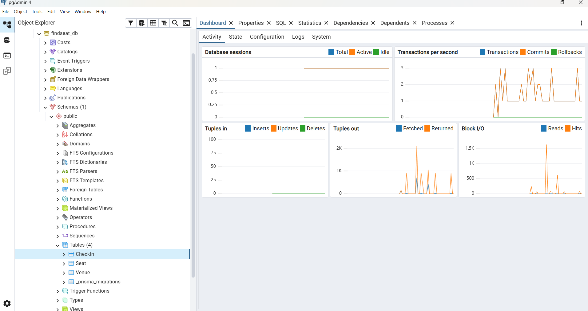

### 14.2 Prisma Studio

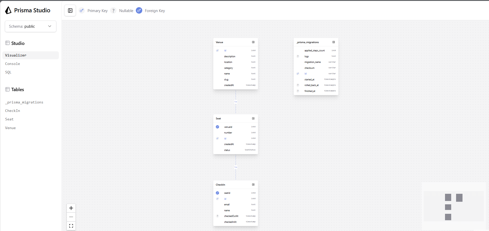

### 14.3 Status Migrasi Prisma

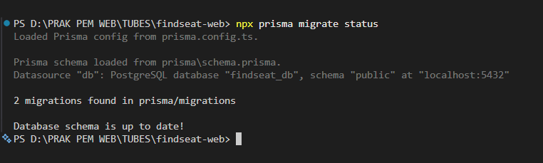

### 14.4 CRUD Venue

**Create Venue**

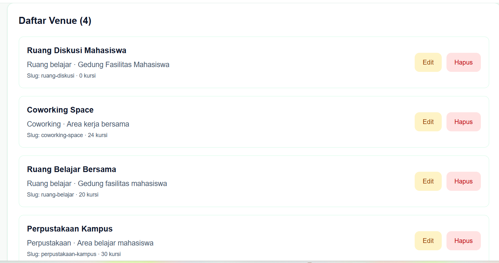

**Update Venue**

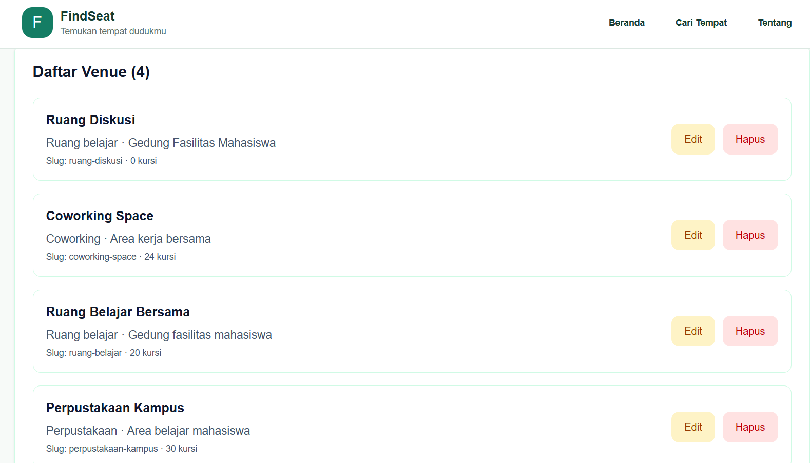

**Delete Venue**

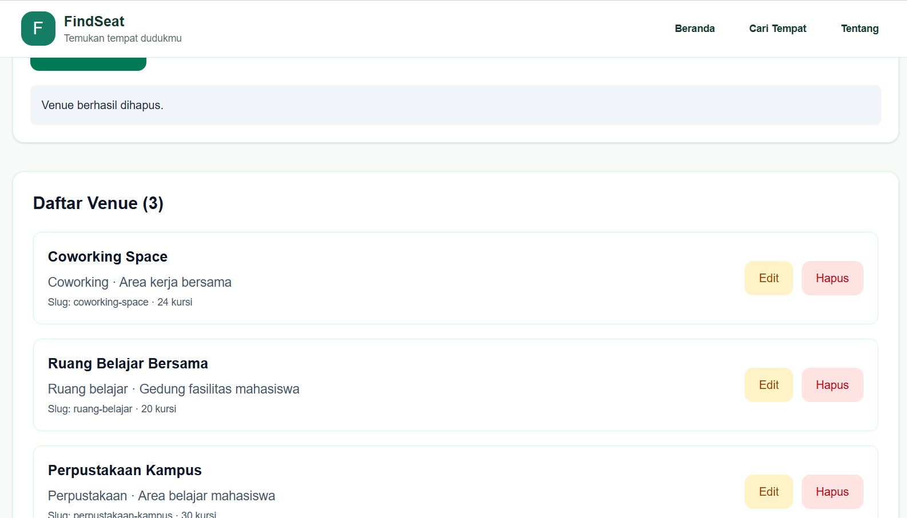

### 14.5 CRUD Seat

**Create Seat**

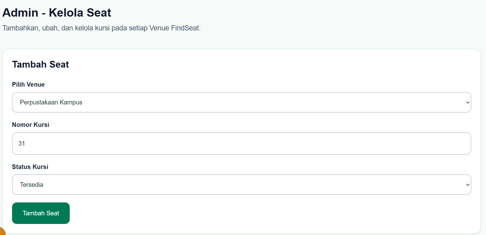

**Update Seat**

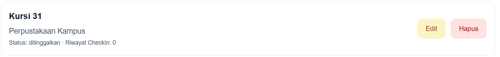

**Delete Seat**

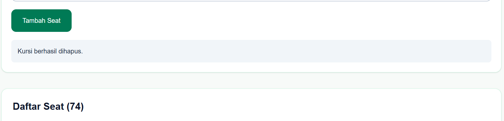

### 14.6 Check-In

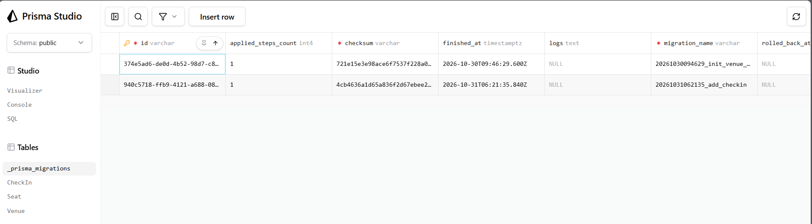

### 14.7 Pembatasan Penghapusan Seat

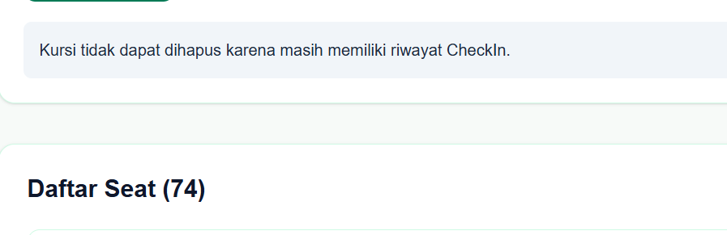

### 14.8 Rollback Transaksi

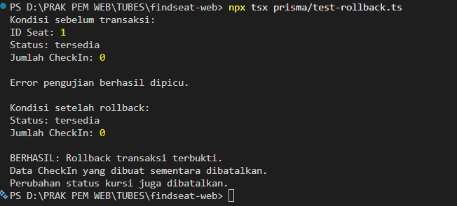

### Daftar File Bukti

| No. | Nama File | Keterangan |
|---:|---|---|
| 1 | `modul-06-database-postgresql.png` | Database `findseat_db` pada pgAdmin 4. |
| 2 | `modul-06-prisma-studio.png` | Model dan data pada Prisma Studio. |
| 3 | `modul-06-migration.png` | Status migrasi Prisma. |
| 4 | `modul-06-venue-create.png` | Pengujian penambahan venue. |
| 5 | `modul-06-venue-update.png` | Pengujian perubahan venue. |
| 6 | `modul-06-venue-delete.png` | Pengujian penghapusan venue. |
| 7 | `modul-06-seat-create.png` | Pengujian penambahan kursi. |
| 8 | `modul-06-seat-update.png` | Pengujian perubahan kursi. |
| 9 | `modul-06-seat-delete.png` | Pengujian penghapusan kursi. |
| 10 | `modul-06-checkin.png` | Data check-in yang tersimpan di database. |
| 11 | `modul-06-restrict-delete.png` | Penolakan penghapusan kursi yang memiliki riwayat check-in. |
| 12 | `modul-06-rollback.png` | Hasil pengujian rollback transaksi. |

## 15. Kesimpulan

Aplikasi FindSeat berhasil diintegrasikan dengan PostgreSQL menggunakan
Prisma ORM. Struktur database dengan model Venue, Seat, dan CheckIn
beserta relasinya berhasil dibuat. Migrasi, generate Prisma Client, dan
pengisian data awal berhasil dilakukan.

Fitur CRUD Venue dan Seat dapat dijalankan dan telah diuji. Proses
check-in berhasil menyimpan data sekaligus memperbarui status kursi.
Pengujian pembatasan penghapusan dan rollback menunjukkan bahwa aturan
relasi serta transaksi database berjalan sesuai harapan. Dengan
demikian, tujuan praktikum Modul 6 untuk menerapkan PostgreSQL dan
Prisma ORM pada produk FindSeat telah tercapai.

**Catatan keamanan:** Halaman administrasi dan Server Action pada tahap
pengembangan ini belum dilengkapi autentikasi dan otorisasi admin. Fitur
administrasi masih digunakan untuk pengujian lokal dan perlu dilindungi
sebelum aplikasi dipublikasikan ke lingkungan produksi.
