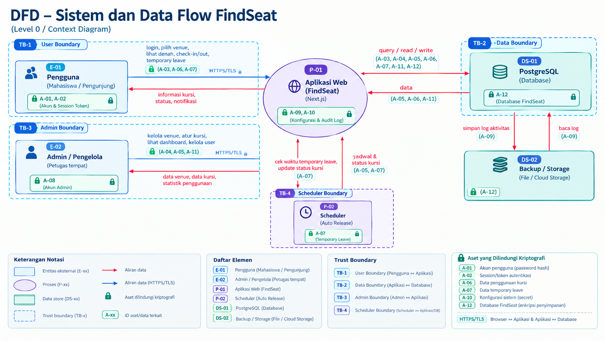

# Tugas 1 — Threat Modeling dan Analisis Risiko Produk FindSeat

**Milestone:** `sec-0.1`  
**Produk:** FindSeat  
**Jenis Produk:** Platform web untuk manajemen penggunaan tempat duduk ruang publik

---

## 1. Deskripsi Produk

**FindSeat** merupakan platform berbasis web yang membantu pengguna menemukan, memilih, dan menggunakan tempat duduk yang tersedia di berbagai ruang publik seperti perpustakaan, coworking space, ruang belajar, ruang tunggu, dan fasilitas publik lainnya.

Pengguna dapat melihat status kursi secara real-time, memilih kursi, melakukan check-in dan check-out, serta menggunakan fitur **temporary leave**. Ketika pengguna meninggalkan kursi sementara, kursi tetap ditahan selama batas waktu tertentu. Jika pengguna tidak kembali sampai batas waktu tersebut, sistem akan melakukan **auto release** sehingga kursi kembali tersedia.

FindSeat juga menyediakan dashboard untuk pengelola tempat. Pengelola dapat mengatur venue dan denah kursi, memantau penggunaan kursi, serta melihat statistik penggunaan fasilitas.

Karena FindSeat menyimpan akun pengguna, data penggunaan kursi, data venue, dan aktivitas pengelola, maka aspek keamanan perlu diperhatikan sejak tahap perancangan.

---

## 2. Tujuan Threat Modeling

Threat modeling dilakukan untuk:

1. Mengidentifikasi aset dan data yang perlu dilindungi.
2. Mengidentifikasi batas kepercayaan (*trust boundary*) pada sistem.
3. Mengidentifikasi ancaman menggunakan metode **STRIDE**.
4. Menilai kemungkinan dan dampak dari setiap risiko.
5. Menentukan lima risiko prioritas.
6. Menentukan kontrol keamanan yang sesuai dengan risiko.
7. Menjadi dasar penerapan keamanan pada pengembangan FindSeat.

---

# 3. Inventaris Aset dan Data

| No. | Aset/Data | Contoh | Klasifikasi | Dampak Jika Terganggu |
|---|---|---|---|---|
| 1 | Akun pengguna | Nama, email, password hash | Sensitif | Pengambilalihan akun |
| 2 | Session/Auth Token | Session cookie, token autentikasi | Sangat Sensitif | Session hijacking |
| 3 | Data pengguna | User ID, nama, email | Sensitif | Kebocoran privasi |
| 4 | Data venue | Nama tempat, ruangan | Internal | Perubahan data fasilitas |
| 5 | Data kursi | ID kursi, lokasi, status | Internal | Manipulasi ketersediaan |
| 6 | Data penggunaan kursi | User, kursi, waktu check-in/out | Sensitif | Pelacakan aktivitas pengguna |
| 7 | Data temporary leave | Waktu mulai dan batas waktu | Internal/Sensitif | Kursi dapat dikuasai secara tidak sah |
| 8 | Data administrator | Akun dan role pengelola | Sangat Sensitif | Pengambilalihan kontrol sistem |
| 9 | Audit log | Login, check-in, perubahan data | Internal | Hilangnya bukti aktivitas |
| 10 | Konfigurasi sistem | API, database, security configuration | Rahasia | Kompromi sistem |
| 11 | Statistik penggunaan | Tingkat okupansi dan pola penggunaan | Internal | Kebocoran informasi operasional |
| 12 | Database FindSeat | Seluruh data aplikasi | Sangat Sensitif | Kerusakan atau kebocoran besar |

### Aset Paling Kritis

Lima aset yang diprioritaskan adalah:

1. Data akun dan autentikasi.
2. Session/token pengguna.
3. Data status kursi.
4. Data penggunaan kursi.
5. Akun dan hak akses administrator.

Aset tersebut diprioritaskan karena kompromi terhadap aset tersebut dapat langsung memengaruhi keamanan pengguna maupun operasional utama FindSeat.

---

# 4. Arsitektur Sistem dan Data Flow

Arsitektur awal FindSeat terdiri dari pengguna/admin, web browser, application server, modul aplikasi, database, audit log, dan scheduler untuk proses auto release.



*Gambar 1. Diagram Arsitektur dan Data Flow FindSeat.*
---

# 5. Trust Boundary

Terdapat beberapa trust boundary pada FindSeat.

### TB-1 — User/Admin ↔ Web Application

Browser pengguna dan administrator berada di luar sistem FindSeat. Seluruh input dari client dianggap **untrusted input** dan harus divalidasi oleh server.

### TB-2 — Application ↔ Database

Database menyimpan data penting sehingga komunikasi dan akses antara application server dan database harus dikontrol.

### TB-3 — User ↔ Admin

User biasa tidak boleh mendapatkan hak akses administrator hanya dengan memanipulasi request atau parameter.

### TB-4 — Scheduler ↔ Application/Database

Proses auto release membutuhkan akses untuk memperbarui status kursi yang telah melewati batas waktu. Akses scheduler harus dibatasi sesuai kebutuhan.

---

# 6. Aliran Data Utama

## 6.1 Alur Login

```text
User
  ↓
Login Form
  ↓ HTTPS
Application Server
  ↓
Authentication
  ↓
Database
  ↓
Session / Token
  ↓
User
```

## 6.2 Alur Pemilihan Kursi

```text
User
  ↓
Request daftar kursi
  ↓
Application Server
  ↓
Database
  ↓
Status kursi
  ↓
User memilih kursi
  ↓
Server melakukan validasi
  ↓
Database Transaction
  ↓
Seat = OCCUPIED
```

## 6.3 Alur Temporary Leave

```text
User
  ↓
Temporary Leave
  ↓
Application Server
  ↓
Validasi kepemilikan kursi
  ↓
Database
  ↓
Seat = TEMPORARY_LEAVE
  ↓
Auto Release Scheduler
  ↓
Waktu habis?
  ↓
Seat = AVAILABLE
```

---

# 7. Identifikasi Ancaman STRIDE

Metode **STRIDE** digunakan untuk mengidentifikasi enam kategori ancaman, yaitu Spoofing, Tampering, Repudiation, Information Disclosure, Denial of Service, dan Elevation of Privilege.

| No. | STRIDE | Elemen | Ancaman | Dampak |
|---|---|---|---|---|
| 1 | Spoofing | Login | Penyerang menggunakan akun pengguna lain | Pengambilalihan akun |
| 2 | Spoofing | Session | Session token dicuri | Penyerang masuk tanpa password |
| 3 | Tampering | Seat API | User memanipulasi request status kursi | Kursi dapat dikuasai secara ilegal |
| 4 | Tampering | Temporary Leave | User mengubah durasi leave melalui request | Kursi ditahan terlalu lama |
| 5 | Tampering | Database | Data kursi diubah tanpa otorisasi | Status kursi tidak valid |
| 6 | Repudiation | Check-in | User menyangkal pernah menggunakan kursi | Sulit melakukan investigasi |
| 7 | Repudiation | Admin | Admin menyangkal perubahan data | Tidak ada bukti aktivitas |
| 8 | Information Disclosure | User API | Data pengguna dapat diakses user lain | Kebocoran data pribadi |
| 9 | Information Disclosure | Dashboard | Statistik/pola penggunaan terekspos | Kebocoran informasi internal |
| 10 | Information Disclosure | Database | Database bocor | Data pengguna terekspos |
| 11 | Denial of Service | Seat API | Request berlebihan ke API | Layanan menjadi lambat/down |
| 12 | Denial of Service | Login | Brute force login | Auth service terbebani |
| 13 | Denial of Service | Database | Query berlebihan | Database overload |
| 14 | Elevation of Privilege | Role | User biasa mengubah role menjadi admin | Pengambilalihan kontrol sistem |
| 15 | Elevation of Privilege | Admin API | User mengakses fungsi admin | Akses tidak sah |
| 16 | Tampering | Input | SQL Injection | Data database dapat dimanipulasi |
| 17 | Tampering | Frontend | XSS | Script berbahaya dijalankan |
| 18 | Spoofing | Check-in | Mekanisme check-in disalahgunakan | Orang lain dapat check-in sebagai user |

---

# 8. Analisis Risiko

Penilaian risiko menggunakan rumus:

> **Risk Score = Likelihood × Impact**

## 8.1 Skala Likelihood

| Nilai | Keterangan |
|---|---|
| 1 | Sangat rendah |
| 2 | Rendah |
| 3 | Sedang |
| 4 | Tinggi |
| 5 | Sangat tinggi |

## 8.2 Skala Impact

| Nilai | Keterangan |
|---|---|
| 1 | Sangat kecil |
| 2 | Kecil |
| 3 | Sedang |
| 4 | Besar |
| 5 | Sangat besar |

---

# 9. Lima Risiko Prioritas

| ID | Risiko | Likelihood | Impact | Risk Score | Prioritas |
|---|---|---:|---:|---:|---|
| R1 | Account/Session Takeover | 4 | 5 | **20** | Kritis |
| R2 | Manipulasi Status Kursi | 4 | 5 | **20** | Kritis |
| R3 | Penyalahgunaan Temporary Leave | 4 | 4 | **16** | Tinggi |
| R4 | Privilege Escalation | 3 | 5 | **15** | Tinggi |
| R5 | Kebocoran Data Pengguna | 3 | 5 | **15** | Tinggi |

---

# 10. Justifikasi Lima Risiko Prioritas

## R1 — Account/Session Takeover

**Likelihood: 4 — Tinggi**

FindSeat menggunakan autentikasi berbasis akun sehingga password dan session menjadi target serangan.

**Impact: 5 — Sangat Besar**

Jika akun berhasil diambil alih, penyerang dapat melakukan aktivitas atas nama pengguna, termasuk menggunakan kursi dan mengakses informasi pengguna.

**Risk Score: 20 — Kritis**

---

## R2 — Manipulasi Status Kursi

**Likelihood: 4 — Tinggi**

Status kursi merupakan data yang dikirim dan diproses melalui aplikasi sehingga dapat menjadi target manipulasi request.

**Impact: 5 — Sangat Besar**

Manipulasi status dapat menyebabkan pengguna mengambil atau menguasai kursi tanpa prosedur yang sah. Hal ini menyerang fungsi utama FindSeat.

**Risk Score: 20 — Kritis**

---

## R3 — Penyalahgunaan Temporary Leave

**Likelihood: 4 — Tinggi**

Fitur temporary leave menggunakan informasi waktu yang berhubungan dengan request pengguna.

**Impact: 4 — Besar**

Jika durasi tidak ditentukan dan divalidasi oleh server, pengguna dapat menahan kursi lebih lama dari batas yang ditentukan.

**Risk Score: 16 — Tinggi**

---

## R4 — Privilege Escalation

**Likelihood: 3 — Sedang**

Endpoint atau fungsi administrator merupakan target yang menarik. Risiko meningkat apabila aplikasi hanya melakukan pengecekan role pada frontend.

**Impact: 5 — Sangat Besar**

Jika user biasa mendapatkan hak admin, penyerang dapat mengubah venue, kursi, atau data lainnya.

**Risk Score: 15 — Tinggi**

---

## R5 — Kebocoran Data Pengguna

**Likelihood: 3 — Sedang**

Kesalahan authorization atau konfigurasi API/database dapat menyebabkan data pengguna dapat diakses oleh pihak yang tidak berhak.

**Impact: 5 — Sangat Besar**

Informasi akun dan riwayat penggunaan kursi dapat menimbulkan masalah privasi apabila terekspos.

**Risk Score: 15 — Tinggi**

---

# 11. Risk Matrix

| Impact \ Likelihood | 1 | 2 | 3 | 4 | 5 |
|---|---:|---:|---:|---:|---:|
| **5 Sangat Besar** | 5 | 10 | **15 R4/R5** | **20 R1/R2** | 25 |
| **4 Besar** | 4 | 8 | 12 | **16 R3** | 20 |
| **3 Sedang** | 3 | 6 | 9 | 12 | 15 |
| **2 Kecil** | 2 | 4 | 6 | 8 | 10 |
| **1 Sangat Kecil** | 1 | 2 | 3 | 4 | 5 |

Prioritas utama berada pada risiko dengan skor **15–20**.

---

# 12. Rencana Kontrol Keamanan

| Risiko | Kontrol | Implementasi |
|---|---|---|
| R1 Account takeover | Password hashing | Gunakan Argon2id atau bcrypt |
| R1 Account takeover | Login rate limiting | Batasi percobaan login berulang |
| R1 Account takeover | Secure session | HttpOnly, Secure, SameSite cookie |
| R1 Account takeover | Session expiration | Session memiliki masa berlaku |
| R2 Seat tampering | Server-side validation | Server menentukan apakah kursi valid |
| R2 Seat tampering | Authorization | Hanya user yang berhak dapat mengubah status |
| R2 Seat tampering | Database transaction | Update status kursi dilakukan secara atomic |
| R2 Seat tampering | Concurrency control | Mencegah dua user mengambil kursi yang sama |
| R3 Temporary leave abuse | Server-side timer | Durasi ditentukan oleh server |
| R3 Temporary leave abuse | Maximum duration | Tetapkan batas waktu, misalnya 15 menit |
| R3 Temporary leave abuse | Auto release | Sistem melepas kursi setelah waktu habis |
| R4 Privilege escalation | RBAC | Role user/admin diperiksa di server |
| R4 Privilege escalation | Authorization middleware | Endpoint admin dilindungi |
| R5 Data disclosure | Access control | User hanya dapat mengakses data yang berhak dilihat |
| R5 Data disclosure | HTTPS/TLS | Enkripsi komunikasi |
| R5 Data disclosure | Data minimization | Hanya menyimpan data yang diperlukan |
| R5 Data disclosure | Encryption | Data sensitif tertentu dienkripsi |
| SQL Injection | Parameterized query | Hindari query SQL dari string mentah |
| XSS | Input/output sanitization | Validasi input dan escape output |
| DoS | Rate limiting | Membatasi request dari user/IP |
| Repudiation | Audit log | Mencatat aktivitas keamanan penting |

---

# 13. Kontrol untuk Integritas Status Kursi

Status kursi merupakan bagian paling penting dari FindSeat. Oleh karena itu, client tidak boleh menentukan status kursi secara langsung.

### Pendekatan yang tidak aman

```json
{
  "seatId": "A12",
  "status": "AVAILABLE"
}
```

Server tidak boleh langsung mempercayai nilai tersebut.

### Pendekatan yang lebih aman

```text
User
  ↓
Request "Check-in Seat A12"
  ↓
Server
  ↓
Cek autentikasi
  ↓
Cek authorization
  ↓
Cek seat exists
  ↓
Cek seat masih AVAILABLE
  ↓
Database Transaction
  ↓
Seat = OCCUPIED
  ↓
Response
```

Dengan pendekatan tersebut, keputusan perubahan status kursi berada di server.

---

# 14. Kontrol Temporary Leave

Durasi temporary leave harus ditentukan dan divalidasi oleh server.

```text
User klik Temporary Leave
          ↓
Server memeriksa user
          ↓
Server menentukan waktu maksimum
          ↓
leave_until = current_time + 15 minutes
          ↓
Database
          ↓
Seat = TEMPORARY_LEAVE
          ↓
Auto Release Scheduler
          ↓
Waktu habis
          ↓
Seat = AVAILABLE
```

User tidak boleh bebas mengirim nilai seperti:

```json
{
  "leaveDuration": 999999
}
```

Server harus memiliki batas maksimum durasi temporary leave.

---

# 15. Authentication dan Kriptografi

Karena FindSeat menyimpan akun dan aktivitas pengguna, keamanan autentikasi menjadi salah satu prioritas.

## 15.1 Password Hashing

Password tidak disimpan dalam bentuk plaintext.

```text
Password
   ↓
Argon2id / bcrypt
   ↓
Password Hash
   ↓
Database
```

Password hash digunakan untuk proses verifikasi tanpa menyimpan password asli.

## 15.2 Enkripsi Data Sensitif

Untuk data tertentu yang membutuhkan perlindungan tambahan:

```text
Plaintext
   ↓
Encryption
   ↓
Ciphertext
   ↓
Database
```

Kunci enkripsi tidak boleh disimpan bersama data terenkripsi.

## 15.3 HTTPS/TLS

Komunikasi antara browser dan server menggunakan HTTPS/TLS:

```text
Browser ↔ HTTPS/TLS ↔ FindSeat Server
```

Hal ini membantu melindungi data selama transmisi.

---

# 16. Audit Log

FindSeat perlu mencatat aktivitas penting untuk membantu mendeteksi dan melakukan investigasi terhadap kejadian keamanan.

Contoh audit log:

| Waktu | User | Aktivitas | Target | Hasil |
|---|---|---|---|---|
| 08:01 | user123 | LOGIN | Account | SUCCESS |
| 08:05 | user123 | CHECK-IN | Seat A12 | SUCCESS |
| 08:20 | user123 | TEMPORARY-LEAVE | Seat A12 | SUCCESS |
| 08:35 | system | AUTO-RELEASE | Seat A12 | SUCCESS |
| 09:10 | admin01 | UPDATE-SEAT | A13 | SUCCESS |
| 09:15 | user321 | ADMIN-ACCESS | Dashboard | DENIED |

Audit log digunakan terutama untuk mengatasi ancaman **Repudiation**.

---

# 17. Prioritas Implementasi Kontrol

Kontrol keamanan FindSeat dapat diterapkan secara bertahap.

### Prioritas 1 — Authentication

- Password hashing.
- Secure session.
- Login rate limiting.
- Session expiration.

### Prioritas 2 — Authorization

- Role-Based Access Control (RBAC).
- Server-side authorization.
- Middleware untuk endpoint admin.

### Prioritas 3 — Seat Integrity

- Server-side validation.
- Database transaction.
- Concurrency control.
- Auto release.

### Prioritas 4 — Data Protection

- HTTPS/TLS.
- Encryption untuk data sensitif.
- Access control.
- Secure database configuration.

### Prioritas 5 — Monitoring

- Audit log.
- Failed login monitoring.
- Monitoring aktivitas mencurigakan.

---

# 18. Kesimpulan

Hasil threat modeling menunjukkan bahwa FindSeat memiliki beberapa ancaman yang berkaitan langsung dengan fitur utama sistem, terutama autentikasi, status kursi, temporary leave, dan role administrator.

Lima risiko prioritas yang ditemukan adalah:

1. **Account/Session Takeover** — skor 20.
2. **Manipulasi Status Kursi** — skor 20.
3. **Penyalahgunaan Temporary Leave** — skor 16.
4. **Privilege Escalation** — skor 15.
5. **Kebocoran Data Pengguna** — skor 15.

Kontrol utama yang direncanakan meliputi password hashing, secure session, rate limiting, server-side validation, database transaction, RBAC, authorization middleware, HTTPS/TLS, encryption, auto release, dan audit log.

Threat model ini menjadi dasar untuk menentukan kontrol keamanan pada tahap pengembangan FindSeat berikutnya.

---

# 19. Milestone `sec-0.1`

Milestone `sec-0.1` mencakup:

- [x] Inventaris aset dan data.
- [x] Arsitektur sistem.
- [x] Data flow.
- [x] Trust boundary.
- [x] Identifikasi ancaman STRIDE.
- [x] Analisis likelihood dan impact.
- [x] Lima risiko prioritas.
- [x] Rencana kontrol keamanan.

**Milestone:** `sec-0.1 — Initial Threat Model & Risk Analysis`

---

# 20. AI Usage

Analisis ini dibantu menggunakan AI untuk membantu menyusun threat modeling, identifikasi ancaman STRIDE, analisis risiko, dan rancangan kontrol keamanan.

Hasil analisis kemudian disesuaikan dengan fitur dan kebutuhan produk FindSeat. Keputusan akhir mengenai ancaman, tingkat risiko, dan kontrol keamanan tetap disesuaikan dengan kondisi produk.

Detail penggunaan AI dicatat pada `AI_LOG.md`.


## 21. Dokumen Pendukung
- Inventaris aset: `asset-inventory.md`
- Data Flow Diagram dan ID elemen: `dfd.md`
- Register lima risiko prioritas: `risk-register.md`
- Catatan penggunaan AI: `AI_LOG.md`

Catatan: pastikan lokasi gambar DFD pada bagian arsitektur sesuai dengan `assets/dfd-findseat.png`. Tambahkan ID elemen dan label kriptografi pada gambar visual agar konsisten dengan `dfd.md`.
